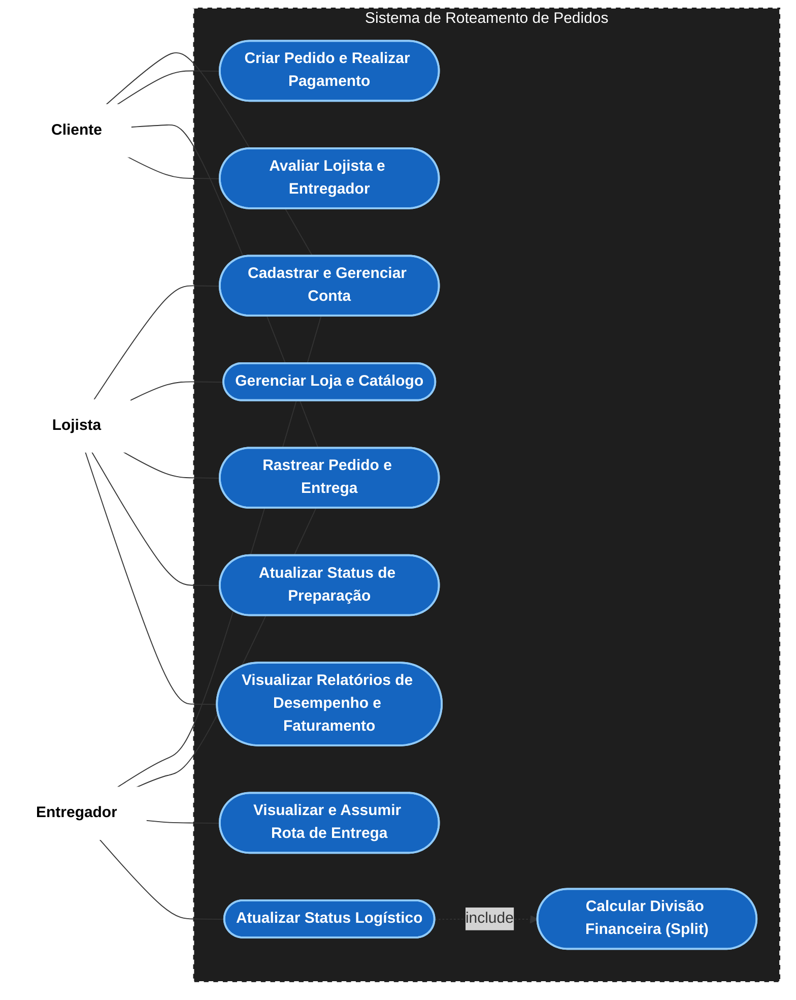

# Diagrama de Casos de Uso

### Mapeamento: Casos de Uso Principais vs. Entidades Envolvidas

Para garantir a rastreabilidade entre os fluxos de interação e o modelo de banco de dados, mapeamos as entidades manipuladas pelos 3 Casos de Uso críticos do sistema:

1. **Criar Pedido e Realizar Pagamento (UC3)**
   - **Ator:** Cliente
   - **Entidades Envolvidas:** `Cliente` (quem faz), `Loja` (de onde compra), `Produto` (o que compra), `Pedido` (a transação), `Item_Pedido` (as quantidades e preços congelados), `Endereco` (destino) e `Historico_Pedido` (auditoria dos status).

2. **Visualizar e Assumir Rota de Entrega (UC6)**
   - **Ator:** Entregador
   - **Entidades Envolvidas:** `Entregador` (quem aceita), `Rota` (o agrupador logístico de até duas entregas), `Entrega` (a tarefa logística) e `Historico_Entrega` (auditoria do aceite).

3. **Atualizar Status Logístico / Finalizar Entrega (UC7)**
   - **Ator:** Entregador
   - **Entidades Envolvidas:** `Entrega` (atualização do status até `entregue`), `Historico_Entrega` (auditoria da conclusão), `Pedido` (sincronização para `concluido`) e o acionamento via _include_ de **Calcular Divisão Financeira (UC10)** na entidade `Divisao_Pagamento` (Split).
