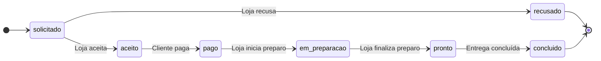
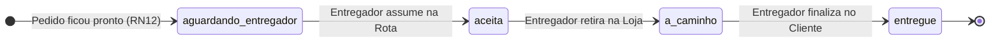

# Modelo de Domínio — Sistema de Roteamento de Entregas

**Disciplinas:** DCC060 (Banco de Dados) & DCC061 (Engenharia de Software)

## Sobre este Documento

Este artefato descreve a visão conceitual e comportamental do domínio do **Sistema de Roteamento de Entregas**: o escopo do problema, o agrupamento das 18 entidades do Diagrama Entidade-Relacionamento (DER), suas regras de relacionamento e cardinalidade, e as máquinas de estados dos fluxos comercial e logístico.

> **Navegação recomendada:**
>
> 1. [Glossário de Domínio](./glossario_de_dominio.md) — definição dos termos de negócio (Linguagem Ubíqua).
> 2. **Modelo de Domínio** (este documento) — como as entidades se relacionam e evoluem no tempo.
> 3. [Dicionário de Dados](./dicionario_dados.md) — especificação física de tabelas, colunas, tipos e restrições.
> 4. [ADRs — Registros de Decisão Arquitetural](./adrs/README.md) — justificativas técnicas das escolhas de modelagem.
> 5. [Especificação de Validações](./especificacao_validacoes.md) — onde cada regra é garantida (Banco vs. Aplicação) e como testá-la.
> 6. [Matriz de Rastreabilidade Bidirecional](./matriz_rastreabilidade.md) — vínculo entre RF, RN e implementação.

---

## 1. Visão Geral e Escopo do Sistema

O sistema é um marketplace de entregas locais no estilo do iFood:

- Cada **Loja** mantém seu próprio catálogo, categorias, preços, taxa de entrega e tempo estimado.
- O **Cliente** realiza um **Pedido** vinculado a uma única loja.
- O **Entregador** assume **Entregas** disponíveis e as agrupa em **Rotas** de até duas entregas simultâneas.
- Os domínios comercial (**Pedido**) e logístico (**Entrega**) são autônomos: cada um possui seu próprio ciclo de status e sua própria trilha de auditoria imutável.

**Fora do escopo definido na E1/E2:** controle de estoque, rastreamento por GPS/mapas em tempo real, cupons/promoções, vínculo trabalhista de entregadores, estorno/reembolso financeiro e o cenário de entrega não realizada/devolução.

---

## 2. Agrupamento das Entidades por Subdomínio

O DER é composto por **18 entidades/relações**, organizadas em cinco responsabilidades:

1. **Identidade e Contato:** `Pessoa`, `Cliente`, `Lojista`, `Entregador`, `Telefone`, `Endereco` e a associação `Pessoa_Endereco`.
2. **Catálogo:** `Loja`, `Produto`, `Categoria` e a associação `Produto_Categoria`.
3. **Comércio e Finanças:** `Pedido`, `Item_Pedido`, `Avaliacao_Loja`, `Avaliacao_Entregador` e `Divisao_Pagamento`.
4. **Logística:** `Entrega` e `Rota`.
5. **Auditoria:** `Historico_Pedido` e `Historico_Entrega`.

### Regra de Especialização (`Pessoa`)

`Pessoa` especializa-se em `Cliente`, `Lojista` e `Entregador` de forma **total e sobreposta** (ver [ADR-003](./adrs/ADR-003-especializacao-pessoa-cardinalidade-minima.md)):

- **Total:** toda pessoa cadastrada deve possuir ao menos um papel no sistema.
- **Sobreposta:** a mesma pessoa física pode acumular mais de um papel (por exemplo, atuar como `Cliente` e `Lojista`).

---

## 3. Relacionamentos e Cardinalidades

> **Convenção de leitura:** o par `(mín, máx)` ao lado de uma entidade indica com quantas instâncias da outra entidade ela se relaciona no modelo conceitual (E2).

- `Lojista` (1,1) **possui** `Loja` (1,N) — todo lojista possui ao menos uma loja, e cada loja pertence a um único lojista.
- `Loja` (1,1) **oferece** `Produto` (0,N) — todo produto pertence a uma única loja.
- `Loja` (1,1) **define** `Categoria` (0,N) — toda categoria pertence a uma única loja.
- `Produto` (0,N) **classifica-se em** `Categoria` (1,N) — todo produto possui ao menos uma categoria, ambos sempre da mesma loja (`RN07`, [ADR-001](./adrs/ADR-001-integridade-loja-chaves-estrangeiras-compostas.md)).
- `Cliente` (1,1) **realiza** `Pedido` (0,N).
- `Loja` (1,1) **recebe** `Pedido` (0,N).
- `Pedido` (1,1) **contém** `Item_Pedido` (1,N) — todo pedido tem ao menos um item; cada item referencia 1 `Produto` da mesma loja do pedido (`RN07`).
- `Pedido` (0,N) **é entregue em** `Endereco` (1,1).
- `Pedido` (1,1) **gera** `Entrega` (0,1) — relação 1:1 opcional (a entrega nasce quando o pedido fica `pronto`).
- `Rota` (0,1) **agrupa** `Entrega` (1,2) — a entrega nasce sem rota até que um entregador a assuma; cada rota agrupa no máximo 2 entregas (`RN02`, [ADR-005](./adrs/ADR-005-rotas-limite-duas-entregas-previsao-entrega.md)).
- `Entregador` (1,1) **percorre** `Rota` (0,N).
- `Pedido` (1,1) **recebe avaliação comercial** `Avaliacao_Loja` (0,1) e **avaliação logística** `Avaliacao_Entregador` (0,1) (`RN06`, `RN13`).
- `Pedido` (1,1) **é faturado em** `Divisao_Pagamento` (0,1) — registrada somente após a conclusão da entrega (`RN05`, [ADR-006](./adrs/ADR-006-modelo-financeiro-registros-pos-entrega.md)).
- `Pessoa` (1,1) **possui** `Telefone` (1,N) — toda pessoa possui ao menos um telefone.
- `Pessoa` (1,N) **reside/vincula-se a** `Endereco` (1,N) via `Pessoa_Endereco`.
- `Cliente` **define como endereço atual** um vínculo de `Pessoa_Endereco` (0,1) pertencente à própria pessoa.
- `Loja` **localiza-se em** `Endereco` (1,1).
- `Pedido` (1,1) **registra** `Historico_Pedido` (1,N) e `Entrega` (1,1) **registra** `Historico_Entrega` (1,N) (`RN04`, `RN08`).

---

## 4. Ciclos de Vida (Máquinas de Estado)

Os ciclos comercial e logístico evoluem de forma independente e sincronizam-se em eventos bem definidos (ver [ADR-004](./adrs/ADR-004-ciclos-status-autonomos-historico-imutavel.md)).

### 4.1 Ciclo de Vida do Pedido (`status_pedido`)

- A loja decide se aceita ou recusa **antes** do pagamento, e só inicia o preparo após o pedido estar `pago`.
- `recusado` e `concluido` são estados finais. Como o pagamento só ocorre após o aceite, pedidos recusados não geram reembolso.

### 4.2 Ciclo de Vida da Entrega (`status_entrega`)

### 4.3 Pontos de Sincronização entre Pedido e Entrega

1. **Criação da Entrega (`RN12`):** ocorre exatamente quando o `Pedido` atinge o status `pronto`. Nesse instante, calcula-se a `previsao_entrega` somando o `tempo_entrega_estimado` da loja ao timestamp atual.
2. **Conclusão do Pedido:** quando a `Entrega` atinge o status `entregue`, o `Pedido` passa automaticamente para `concluido`.
3. **Gatilhos Pós-Entrega:** somente após a entrega estar `entregue` são liberados o registro da `Divisao_Pagamento` (`RF09`, `RN05`) e o envio de `Avaliacao_Loja` e `Avaliacao_Entregador` (`RF08`, `RN13`).
